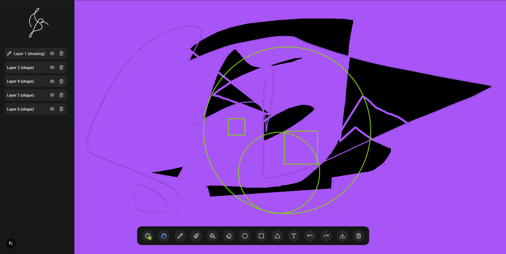

# Blackboard

A modern, feature-rich digital drawing application built with Next.js and React. Create, edit, and manage multiple drawing layers with a comprehensive set of drawing tools.



## Features

- **Multi-layer Support**: Create and manage multiple drawing layers with individual visibility and opacity controls
- **Comprehensive Drawing Tools**:
  - Pencil and brush with adjustable sizes
  - Eraser tool
  - Shape tools (circle, square, triangle)
  - Text tool with customizable fonts
  - Fill tool for color filling
  - Selection tool for layer manipulation
- **Advanced Layer Management**:
  - Drag and drop layer reordering
  - Individual layer visibility toggle
  - Layer opacity adjustment
  - Layer type conversion
- **Intuitive Interface**:
  - Floating toolbar with hover-activated panels
  - Color palette with preset and custom colors
  - Brush size slider
  - Text formatting options
- **Canvas Operations**:
  - Undo/Redo functionality
  - Clear canvas
  - Save drawings as PNG
- **Responsive Design**: Works on desktop and mobile devices

## Technology Stack

- **Framework**: Next.js 14 with App Router
- **Language**: TypeScript
- **Styling**: Tailwind CSS
- **Animations**: Framer Motion
- **Icons**: Lucide React
- **Canvas**: HTML5 Canvas API
- **State Management**: React Context API

## Getting Started

### Prerequisites

- Node.js 18+
- npm, yarn, pnpm, or bun

### Installation

1. Clone the repository:

```bash
git clone <repository-url>
cd blackboard
```

2. Install dependencies:

```bash
npm install
# or
yarn install
# or
pnpm install
```

3. Run the development server:

```bash
npm run dev
# or
yarn dev
# or
pnpm dev
# or
bun dev
```

4. Open [http://localhost:3000](http://localhost:3000) in your browser to see the application.

## Usage

### Drawing Tools

- **Select Tool**: Click and drag to move or resize layers
- **Pencil/Brush**: Draw freehand with adjustable brush sizes
- **Eraser**: Remove parts of your drawing
- **Shapes**: Create geometric shapes (circles, squares, triangles)
- **Text**: Add text with customizable fonts and sizes
- **Fill**: Fill enclosed areas with color

### Layer Management

- **Create Layers**: Layers are automatically created when using different tools
- **Reorder Layers**: Drag and drop layers in the layers panel
- **Toggle Visibility**: Click the eye icon to show/hide layers
- **Delete Layers**: Click the trash icon (always maintains at least one layer)

### Shortcuts

- **Undo**: Ctrl/Cmd + Z
- **Redo**: Ctrl/Cmd + Y
- **Save**: Ctrl/Cmd + S

## Project Structure

```
blackboard/
├── app/                    # Next.js app directory
│   ├── layout.tsx         # Root layout
│   ├── page.tsx           # Main page
│   └── globals.css        # Global styles
├── components/            # React components
│   ├── drawing-canvas.tsx # Main canvas component
│   ├── drawing-context.tsx # State management
│   ├── drawing-tools-dock.tsx # Floating toolbar
│   ├── layers-panel.tsx   # Layer management
│   ├── color-palette.tsx  # Color selection
│   └── ui/               # UI components
├── lib/                  # Utility functions
└── public/              # Static assets
```

## Components Overview

- **DrawingCanvas**: Main canvas component handling all drawing operations
- **DrawingProvider**: Context provider for global state management
- **DrawingToolsDock**: Floating toolbar with all drawing tools
- **LayersPanel**: Side panel for layer management
- **ColorPalette**: Color selection interface
- **FloatingDock**: Animated toolbar component

## Development

### Available Scripts

- `npm run dev` - Start development server
- `npm run build` - Build for production
- `npm run start` - Start production server
- `npm run lint` - Run ESLint

### Code Style

This project uses:

- ESLint for code linting
- TypeScript for type safety
- Tailwind CSS for styling
- Prettier for code formatting

## Contributing

1. Fork the repository
2. Create a feature branch (`git checkout -b feature/amazing-feature`)
3. Commit your changes (`git commit -m 'Add some amazing feature'`)
4. Push to the branch (`git push origin feature/amazing-feature`)
5. Open a Pull Request

## License

This project is licensed under the MIT License.

## Acknowledgments

- Built with Next.js and React
- UI components inspired by modern design systems
- Canvas API for drawing functionality
- Framer Motion for animations
